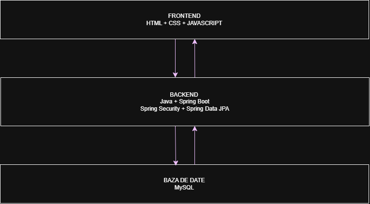

# Arhitectura aplicatiei - Academic Events

## 1. Descriere generala

Aplicatia va utiliza o arhitectura pe trei niveluri, formata din frontend, backend si baza de date. Componentele vor comunica prin intermediul REST API.

## 2. Frontend

Frontendul va fi dezvoltat folosind HTML, CSS si JavaScript. Acesta va asigura interfata grafica si interactiunea utilizatorilor cu aplicatia.

Principalele functionalitati:
- Afisarea evenimentelor disponibile.
- Formulare pentru autentificare si inregistrare.
- Inscrierea la evenimente.
- Administrarea evenimentelor si participantilor.

## 3. Backend

Backendul va fi dezvoltat folosind Java si Spring Boot. Acesta va gestiona logica aplicatiei, prelucrarea datelor si comunicarea cu baza de date.

Componente principale:
- Spring Boot pentru dezvoltarea REST API.
- Spring Data JPA si Hibernate pentru accesul la date.
- Spring Security pentru autentificare si autorizare.
- Maven pentru gestionarea dependentelor.

## 4. Baza de date

Se va utiliza MySQL pentru stocarea persistenta a informatiilor.

Principalele entitati vor fi:
- User - informatii despre utilizatori si rolurile acestora.
- Event - informatii despre evenimente.
- Registration - inscrierile participantilor.
- Agenda - programul evenimentelor.
- Feedback - opiniile participantilor.

## 5. Comunicarea intre componente

Frontendul trimite cereri HTTP catre backend prin intermediul REST API. Backendul prelucreaza cererile, verifica datele 
si interactioneaza cu baza de date MySQL. Rezultatele sunt returnate frontendului in format JSON si afisate utilizatorului.

## 6. Securitate

Accesul la aplicatie va fi protejat prin autentificare si autorizare. In functie de rolul utilizatorului (Admin, Organizator sau Participant), vor fi disponibile functionalitati diferite.

## 7. Diagrama arhitecturii

